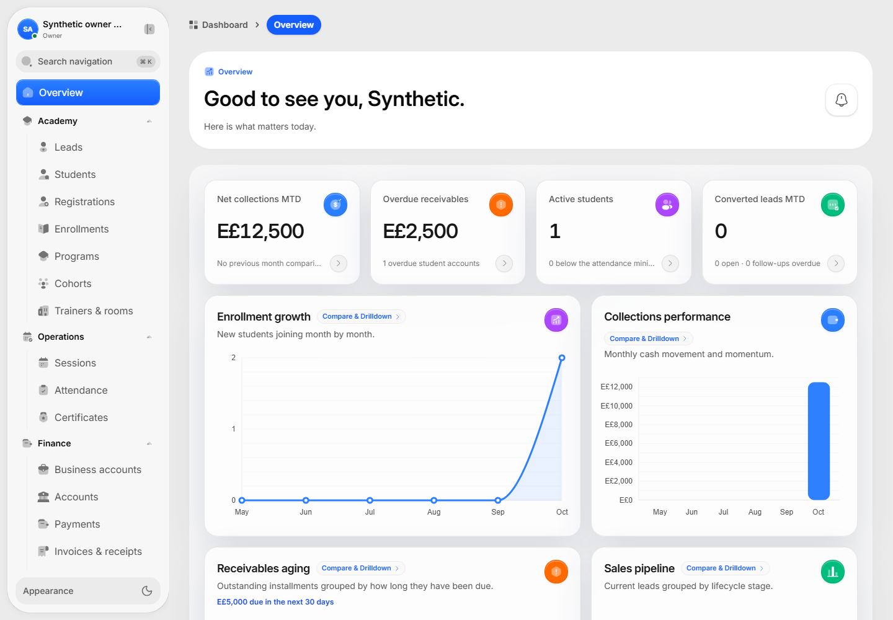
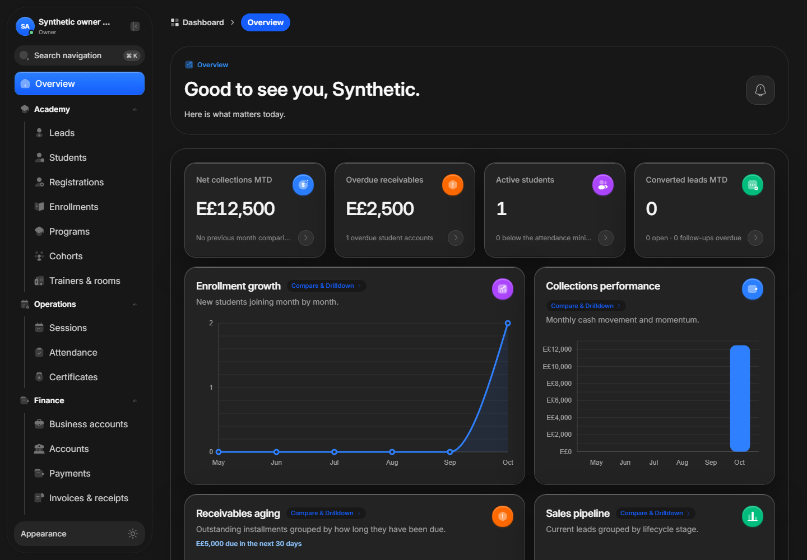
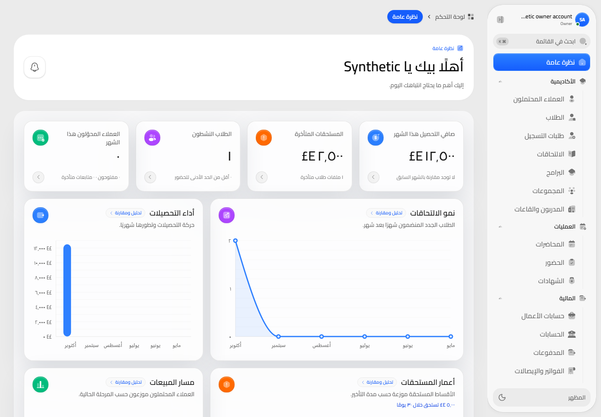
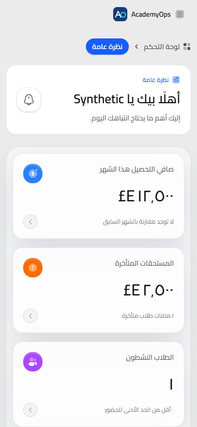
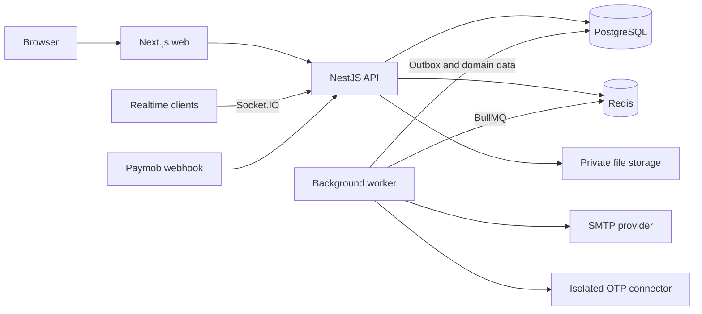

# AcademyOps

**A full-stack operations platform for training academies.**

[](https://github.com/software-eng-mohamed/AcademyOps/actions/workflows/ci.yml)

AcademyOps brings student enrollment, course scheduling, attendance, finance, and certificates
into one Arabic/English application. It combines a responsive Next.js interface with a NestJS
backend, PostgreSQL business rules, and background processing with Redis and BullMQ.

The project demonstrates domain workflows, role-based interfaces, typed API contracts, and
deployment automation. It targets one academy organization with branch- and role-scoped access.

## Preview

The [interactive demo](docs/demo.md) runs these same screens against an internal mock API.
It includes fictional academy data and browser-local changes, with no real payments or messages.

These automated-test screenshots use **synthetic accounts and fixture data**. The figures shown
are demonstration values, not production usage or business results.



<details>
<summary>Dark mode</summary>



</details>

<details>
<summary>Arabic and mobile layout</summary>



<p align="center">
  
</p>

</details>

## Features

| Area                      | Implemented capabilities                                                                                   |
| ------------------------- | ---------------------------------------------------------------------------------------------------------- |
| **Academy operations**    | Programs, curricula, cohorts, rooms, trainers, sessions, and scheduling conflict checks                    |
| **Students and CRM**      | Leads, student records, registration review, enrollments, transfers, and cancellation decisions            |
| **Finance**               | Pricing approvals, installment schedules, payment allocation, invoices, receipts, refunds, and receivables |
| **Attendance**            | Rotating QR check-in, manual attendance, correction history, makeup records, and attendance policies       |
| **Certificates**          | Attendance/payment eligibility checks, responsible-user PDF upload, controlled downloads, and verification |
| **Access and auditing**   | Scoped permissions, opaque sessions, CSRF protection, TOTP step-up, and audit records                      |
| **Web experience**        | Arabic/English, RTL support, role-specific workspaces, and responsive screens                              |
| **Background processing** | Transactional outbox, BullMQ jobs, email delivery, attendance maintenance, and private report exports      |

Configurable adapters cover Paymob payments, SMTP delivery, private local/S3-compatible storage,
and an isolated WhatsApp OTP connector. Live provider credentials and acceptance testing are
separate deployment requirements.

## Technology

| Layer         | Stack                                                                                |
| ------------- | ------------------------------------------------------------------------------------ |
| Web           | Next.js 16, React 19, TypeScript, Tailwind CSS, TanStack Query, React Hook Form, Zod |
| API           | NestJS 11, Prisma, OpenAPI, Socket.IO                                                |
| Data and jobs | PostgreSQL 17, Redis, BullMQ                                                         |
| Testing       | Vitest, Playwright, Axe, PostgreSQL/Redis integration suites, k6 harness             |
| Tooling       | pnpm workspaces, Turborepo, ESLint, Biome, Prettier                                  |
| Deployment    | Docker, Caddy, optional WireGuard cluster, Prometheus, Grafana, Loki                 |

Exact versions are pinned in the workspace manifests and lockfile.

## Architecture

The API is a **modular monolith**. The worker is a separate process built from the same backend
modules and data model.



- PostgreSQL owns academic and financial truth; Redis handles transport, retries, and coordination.
- Domain changes and their outbox events share a database transaction.
- Posted ledger entries are append-only; corrections use explicit reversal workflows.
- The web application accesses data through the API, without connecting directly to Prisma.

```text
apps/
  api/             NestJS modules, Prisma models, migrations, and backend tests
  web/             Next.js application
  worker/          Outbox, scheduled maintenance, and background jobs
  otp-connector/   Isolated WhatsApp linked-device connector
packages/
  contracts/       Domain states, permissions, and shared rules
  api-client/      OpenAPI contract and typed HTTP client
  ui/              Shared interface components
  design-tokens/   Shared design values
  line-gate/       Source maintainability checks
tests/             Browser, integration-support, and load-test tooling
deploy/            Container images and deployment templates
docs/              Architecture decisions, contracts, and operating guides
```

## Run locally

Requirements: **Node.js 22.12 or newer**, **pnpm 11** (the pinned version is in `package.json`),
and **Docker with Compose v2**.

For a fresh checkout, create local configuration files. Do not overwrite an existing environment:

```powershell
git clone https://github.com/software-eng-mohamed/AcademyOps.git
cd AcademyOps
Copy-Item .env.example .env
Copy-Item .env.example apps/api/.env
pnpm install --frozen-lockfile
```

On macOS/Linux, use `cp` for the two copy commands. Review the database and Redis URLs before database
commands; the example points to local Docker services.

To create a local Owner login, add your own `BOOTSTRAP_OWNER_EMAIL` and
`BOOTSTRAP_OWNER_PASSWORD` to `apps/api/.env` before seeding. The password must have at least
12 characters. The seed creates an Owner only when both variables are supplied; there is no
shared default login.

```powershell
docker compose up -d --wait postgres redis mailpit
pnpm db:generate
pnpm db:deploy
pnpm db:seed
pnpm dev
```

Windows also has `pnpm dev:local -Seed` after configuring the local environment. The launcher
checks Docker, starts local services, generates Prisma, and applies migrations.

| Service                  | Local address                         |
| ------------------------ | ------------------------------------- |
| Web development          | http://localhost:3130                 |
| API                      | http://localhost:3001/api/v1          |
| Swagger (non-production) | http://localhost:3001/docs            |
| Mailpit inbox            | http://localhost:58025                |
| PostgreSQL / Redis       | `localhost:55432` / `localhost:16379` |
| Web production image     | `localhost:3100`                      |

The API and worker read the backend environment. Web scripts also read the root `.env`. Replace
example signing/encryption values with independently generated secrets before non-local use.
WhatsApp pairing needs a separate 32-byte Base64 encryption key shared only between the API and
connector; it is optional for local email/password development.

## Verification

The [verification record](docs/verification.md) lists completed checks, measured load results,
and the deployment boundaries. The [test suite guide](tests/README.md) explains each command.

```powershell
pnpm verify
pnpm verify:release
```

`verify` runs dependency pinning, source-line limits, formatting, linting, type checking, tests,
and production builds. `verify:release` adds the production dependency audit, license policy,
and Prisma validation. Focused checks include `pnpm web:verify`, `pnpm api:contract:check`,
`pnpm db:validate`, `pnpm web:e2e`, and `pnpm load:verify`.

Use a **disposable test database** for integration and browser tests. Supply test connection
variables explicitly or configure `apps/api/.env.test`; do not use production credentials or
data. PostgreSQL/Redis suites require running services to establish integration coverage. CI
provisions isolated services; a local run without them may skip those tests. Browser and load
suites have separate setup in [tests/e2e](tests/e2e/README.md) and [tests/load](tests/load/README.md).

Compilation and mocked UI tests do not establish live payment delivery, messaging delivery,
disaster recovery, or production acceptance. Historical verification notes in the implementation
status are dated records, not claims about the current checkout.

## Deployment

- [Single VPS](deploy/single-vps/README.md): application, data services, and monitoring on one host.
- [Three-VPS cluster](deploy/multi-vps/README.md): ingress, application, and database hosts over WireGuard.
- [Release and operations](docs/deployment.md): image, configuration, and operating details.

Deployment files are templates. Supply your own domains, inventories, credentials, secrets, and
backup destinations. Keep local configuration, exports, private keys, real account records, and
generated inventories outside Git.

The WhatsApp connector uses an unofficial linked-device library. Assess provider compatibility
and operational requirements before enabling it. Paymob, SMTP, storage, malware scanning,
backups, and production user acceptance require environment-specific validation.

## Documentation

- [Domain contracts and financial rules](docs/domain-contracts.md)
- [API contracts](docs/api-contracts.md) and [endpoint catalog](docs/api-catalog.md)
- [Workspace overview](docs/workspace-overviews.md) and [architecture decisions](docs/adr)
- [Implementation status and remaining gates](docs/implementation-status.md)
- [Public project summary](docs/public-project.md)
- [Security and responsible reporting](SECURITY.md)

منصة لإدارة عمليات الأكاديميات تشمل الطلاب، التسجيل، الجداول، الحضور، الحسابات، والشهادات،
بواجهة عربية/إنجليزية وصلاحيات حسب الدور والفرع. راجع أدلة التشغيل قبل استخدام بيانات فعلية.
